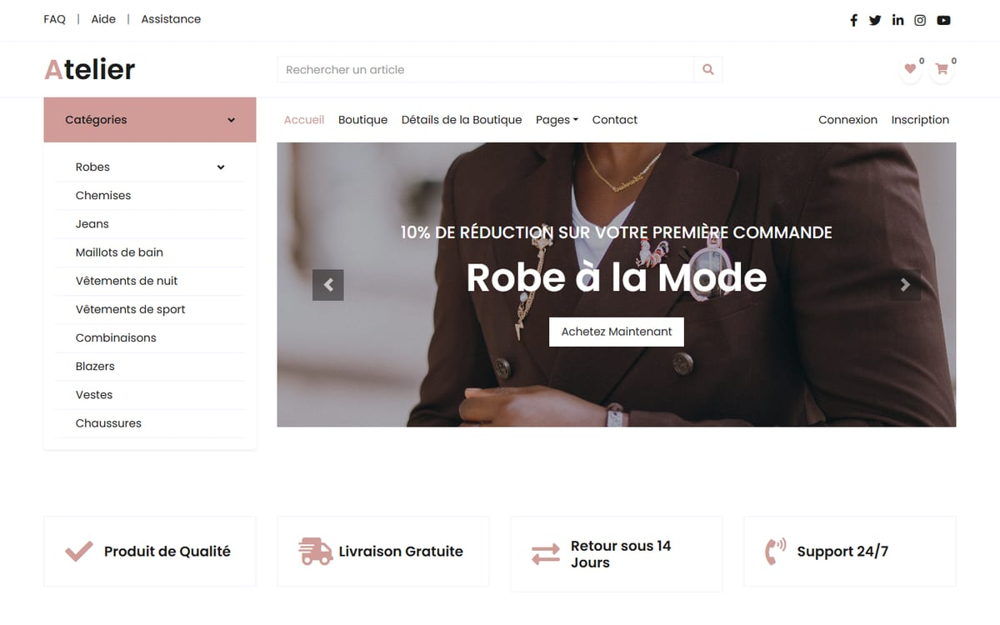
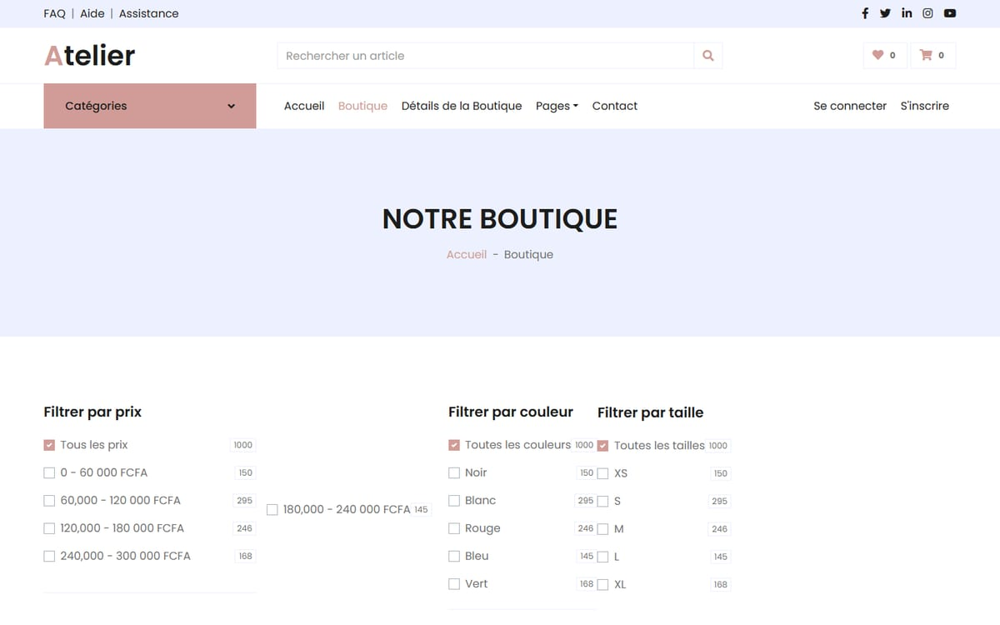
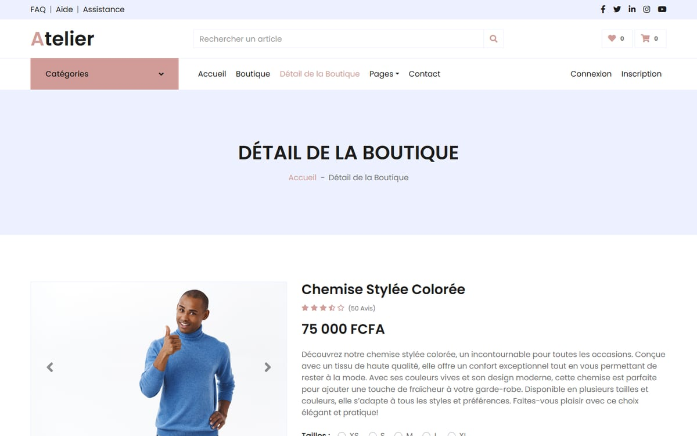
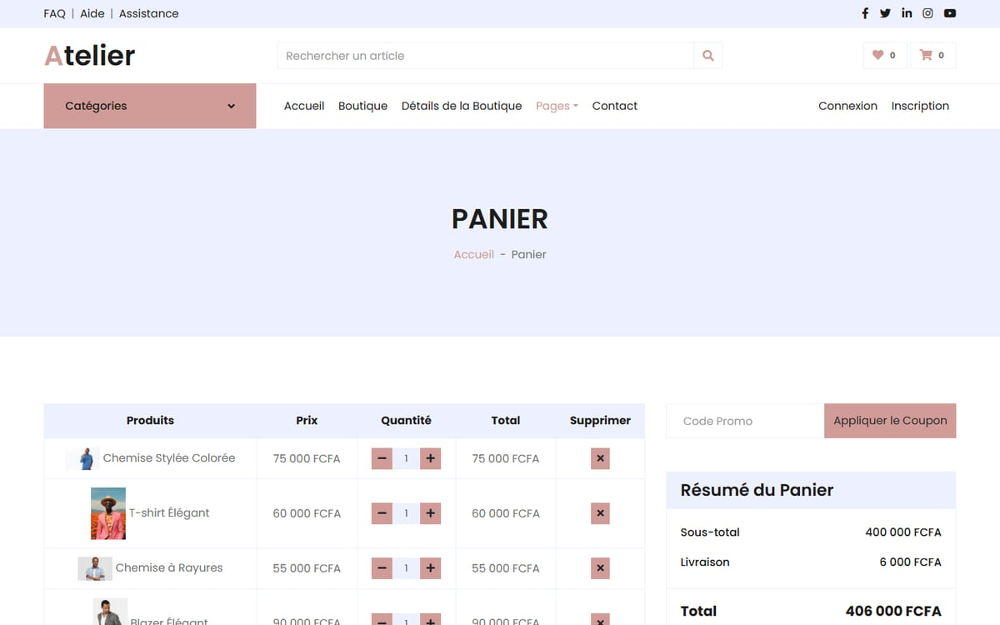

# Atelier

A responsive fashion e-commerce website: home page with categories and offers, catalogue with filters, product page, cart and checkout.

**Live:** https://kteken10.github.io/atelier_ecommerce/

| Home | Shop |
|:---:|:---:|
|  |  |

| Product | Cart |
|:---:|:---:|
|  |  |

## Features

- Home page: category menu, hero carousel, service highlights, categories, seasonal offers and trending products.
- Shop: filters by price, colour and size, search and sorting.
- Product page: gallery, sizes and colours, description and reviews tabs, related products.
- Cart with promo code and order summary, checkout with billing details and payment options.
- Contact page with a form.
- Interface in French, prices in FCFA.

## Tech stack

HTML5, CSS3 (Bootstrap 4, SCSS sources), JavaScript (jQuery, Owl Carousel). Built on a free Bootstrap e-commerce template, then rebranded, translated into French and extended. Deployed with GitHub Pages.

## Run locally

Open `index.html` in a browser, or serve the folder:

```bash
python -m http.server 8000
```

## Author

**Dissang Kevin** · Mobile AI Engineer
[Portfolio](https://dissangkevin.work) · [GitHub](https://github.com/kteken10)
